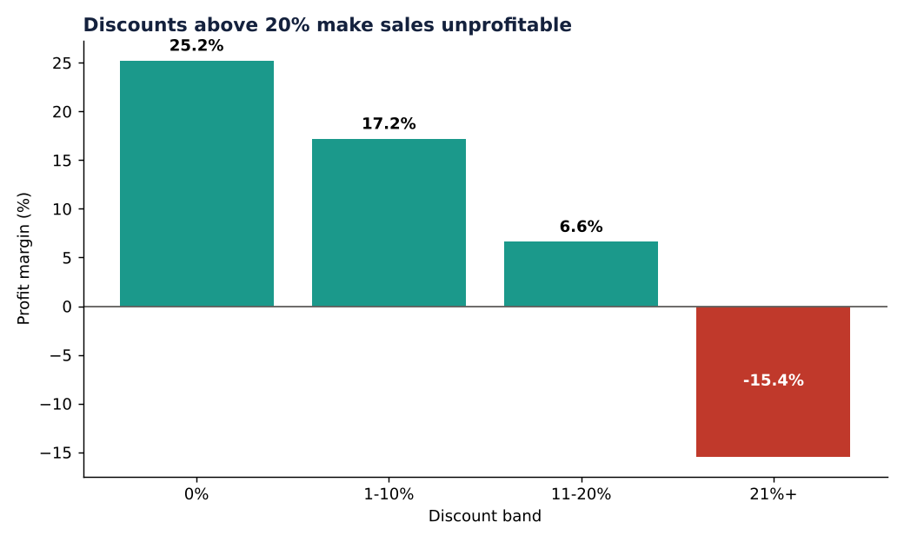
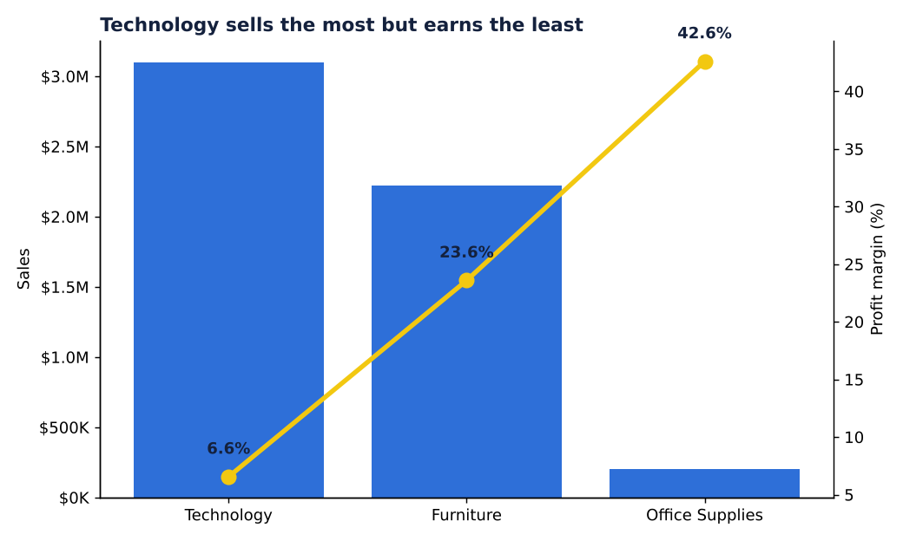
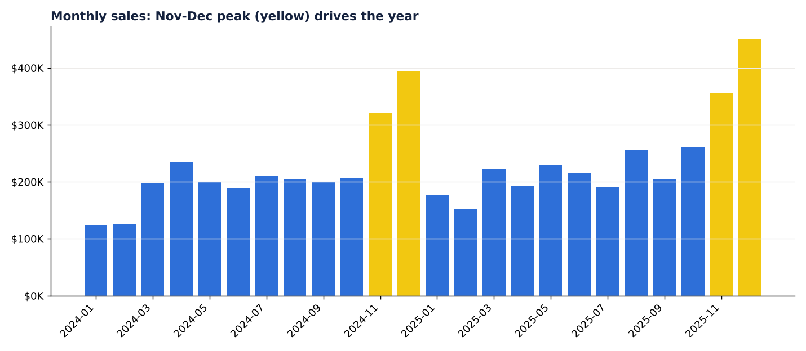

# Sales Performance Analytics: from raw data to business insights

An end-to-end Business Intelligence project: messy raw sales data is cleaned with **Python**, modelled as a
**star schema**, analysed with **SQL** and **pandas**, and prepared for a **Power BI** dashboard.

> The dataset is **synthetic** (generated by `src/generate_data.py`). No real company or person is represented.

## Business questions
1. How are sales and profit evolving, and when are the peaks?
2. Which categories, products and regions drive profit?
3. How do discounts affect profitability?
4. Who are the most valuable customers and segments?

## Key findings
| Finding | Detail |
|---|---|
| **Deep discounts destroy profit** | Lines discounted above 20% have a **-15.4% margin** and lose about $144K |
| **Technology: high sales, low margin** | 6.6% margin versus 23.6% for Furniture and 42.6% for Office Supplies |
| **Strong seasonality** | November and December generate **28%** of annual sales |
| **Growth with margin pressure** | Sales **+11.6%** in 2025, margin slipped from 14.9% to 14.6% |





**Recommendations:** cap discounts at 20%, review Technology pricing and supplier costs, and plan inventory
and marketing around the November-December peak. Full numbers are in [`reports/kpi_summary.md`](reports/kpi_summary.md).

## Project workflow
```
generate_data.py  ->  data/raw/sales_raw.csv  (7,655 rows, deliberately dirty)
clean_data.py     ->  data/clean/ star schema (fact_sales + 3 dimensions)
run_sql.py        ->  10 KPI queries in sql/kpi_queries.sql
analysis.py       ->  charts in images/ + reports/kpi_summary.md
powerbi/          ->  data model, DAX measures and report layout guide
```

### Data cleaning performed
- Standardised text (extra spaces, upper/lower case) in customer and segment fields
- Parsed two mixed date formats (`YYYY-MM-DD` and `DD/MM/YYYY`)
- Removed 150 duplicate rows
- Recovered 106 missing regions from the city
- Validated business rules (positive quantities, discount range, ship date after order date)
- Calculated `sales`, `cost` and `profit`

### Data model (star schema)
```
dim_customer --\
dim_product  ---- fact_sales ---- dim_date
```

## Skills demonstrated
`Python (pandas, matplotlib)` | `SQL (joins, CTE-style subqueries, window functions, CASE)` |
`Data cleaning and validation` | `Dimensional modelling` | `KPI design` | `DAX` | `Data storytelling`

## How to run
```bash
git clone <your-repo-url>
cd bi-sales-analytics
pip install -r requirements.txt
python src/generate_data.py
python src/clean_data.py
python src/run_sql.py
python src/analysis.py
```
Then follow [`powerbi/POWER_BI_GUIDE.md`](powerbi/POWER_BI_GUIDE.md) to build the dashboard.

## Author
**Hayat Rahmoun**: Data Analyst | Power BI - Zoho Analytics - Python - SQL
[LinkedIn](https://linkedin.com/in/hayat-rahmoun-b49829221)
